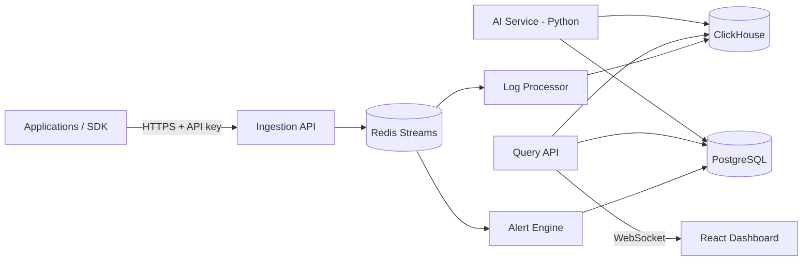

# LogSage

Log and incident analysis platform: collects application logs, groups similar errors, detects anomalies, and suggests likely root causes when an incident opens. Think "mini Datadog + AI".

> Status: early development (pre-v0.1). See [docs/roadmap.md](docs/roadmap.md).

## Why

When production breaks, the answer is hidden in millions of log lines. LogSage ingests them at high volume, makes them searchable, groups them into distinct problems, and links incidents to recent changes.

## Architecture (planned)



Details: [docs/architecture.md](docs/architecture.md) and [docs/adr](docs/adr).

## Tech stack

Go (backend) · ClickHouse (logs/metrics) · PostgreSQL (relational data) · Redis Streams (queue) · React + TypeScript (dashboard) · Python + FastAPI (AI service) · Docker Compose · GitHub Actions

## Getting started

```bash
cp .env.example .env
docker compose -f infra/docker-compose.yml up -d
```

Run the backend (Go 1.23+). By default accepted events are kept in memory:

```bash
cd backend
INGEST_API_KEY=dev-key go run ./cmd/ingest   # listens on HTTP_ADDR, default :8080
curl localhost:8080/healthz                    # {"status":"ok"}  (liveness)
curl localhost:8080/readyz                     # {"status":"ready"} (readiness)
curl -X POST localhost:8080/v1/ingest -H "X-API-Key: dev-key" -H "Content-Type: application/json"   -d '{"events":[{"timestamp":"2026-11-06T10:15:30Z","level":"info","service":"demo","message":"hello"}]}'
# {"accepted":1}
```

To publish to a Redis Stream instead:

```bash
docker compose -f infra/docker-compose.yml up -d redis
cd backend
PUBLISHER=redis REDIS_ADDR=localhost:6379 INGEST_API_KEY=dev-key go run ./cmd/ingest
# after sending events:
docker compose -f infra/docker-compose.yml exec redis redis-cli XLEN logsage:events
```

Run the Redis integration tests (skipped when `REDIS_TEST_ADDR` is unset):

```bash
cd backend
REDIS_TEST_ADDR=localhost:6379 go test ./internal/ingest -count=1
```

Configuration is read from environment variables: `HTTP_ADDR`, `LOG_LEVEL` (`debug|info|warn|error`), `LOG_FORMAT` (`json|text`), `INGEST_API_KEY` (required), the `INGEST_MAX_*` limits, `PUBLISHER` (`memory|redis`) and the `REDIS_*` settings. See `.env.example` and the ingest contract in `docs/architecture.md`.

## Documentation

- [Requirements](docs/requirements.md)
- [Architecture](docs/architecture.md)
- [Roadmap](docs/roadmap.md)
- [Claude Code workflow](docs/claude-code-workflow.md)
- [Architecture decisions](docs/adr)
