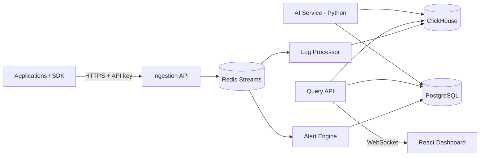

# LogSage

Log and incident analysis platform: collects application logs, groups similar errors, detects anomalies, and suggests likely root causes when an incident opens. Think "mini Datadog + AI".

> Status: early development (pre-v0.1). See [docs/roadmap.md](docs/roadmap.md).

## Why

When production breaks, the answer is hidden in millions of log lines. LogSage ingests them at high volume, makes them searchable, groups them into distinct problems, and links incidents to recent changes.

## Architecture (planned)



Details: [docs/architecture.md](docs/architecture.md) and [docs/adr](docs/adr).

## Tech stack

Go (backend) · ClickHouse (logs/metrics) · PostgreSQL (relational data) · Redis Streams (queue) · React + TypeScript (dashboard) · Python + FastAPI (AI service) · Docker Compose · GitHub Actions

## Getting started

```bash
cp .env.example .env
docker compose -f infra/docker-compose.yml up -d
```

Backend run instructions will be added with v0.1.

## Documentation

- [Requirements](docs/requirements.md)
- [Architecture](docs/architecture.md)
- [Roadmap](docs/roadmap.md)
- [Claude Code workflow](docs/claude-code-workflow.md)
- [Architecture decisions](docs/adr)
