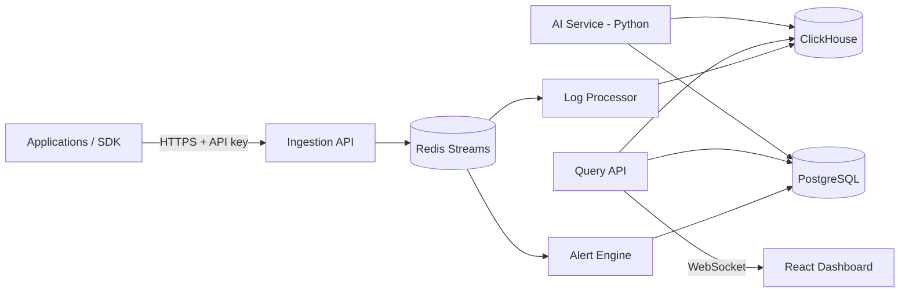

# LogSage

Log and incident analysis platform: collects application logs, groups similar errors, detects anomalies, and suggests likely root causes when an incident opens. Think "mini Datadog + AI".

> Status: early development (pre-v0.1). See [docs/roadmap.md](docs/roadmap.md).

## Why

When production breaks, the answer is hidden in millions of log lines. LogSage ingests them at high volume, makes them searchable, groups them into distinct problems, and links incidents to recent changes.

## Architecture (planned)



Details: [docs/architecture.md](docs/architecture.md) and [docs/adr](docs/adr).

## Tech stack

Go (backend) · ClickHouse (logs/metrics) · PostgreSQL (relational data) · Redis Streams (queue) · React + TypeScript (dashboard) · Python + FastAPI (AI service) · Docker Compose · GitHub Actions

## Getting started

```bash
cp .env.example .env
docker compose -f infra/docker-compose.yml up -d
```

Run the backend (Go 1.23+). By default accepted events are kept in memory:

```bash
cd backend
INGEST_API_KEY=dev-key go run ./cmd/ingest   # listens on HTTP_ADDR, default :8080
curl localhost:8080/healthz                    # {"status":"ok"}  (liveness)
curl localhost:8080/readyz                     # {"status":"ready"} (readiness)
curl -X POST localhost:8080/v1/ingest -H "X-API-Key: dev-key" -H "Content-Type: application/json"   -d '{"events":[{"timestamp":"2026-11-06T10:15:30Z","level":"info","service":"demo","message":"hello"}]}'
# {"accepted":1}
```

To run the full pipeline (ingest -> Redis Stream -> processor -> ClickHouse):

```bash
docker compose -f infra/docker-compose.yml up -d redis clickhouse
cd backend
PUBLISHER=redis REDIS_ADDR=localhost:6379 INGEST_API_KEY=dev-key go run ./cmd/ingest
# in a second terminal:
REDIS_ADDR=localhost:6379 CLICKHOUSE_USER=logsage CLICKHOUSE_PASSWORD=change-me go run ./cmd/processor
curl localhost:8081/stats      # stream length, pending, lag, counters
# after sending events (read with FINAL: delivery is at-least-once, duplicates collapse):
docker compose -f infra/docker-compose.yml exec clickhouse clickhouse-client --query "SELECT count() FROM logsage.logs FINAL"
```

Search the stored logs with the read-only query API (its key must differ from the ingest key):

```bash
cd backend
QUERY_API_KEY=dev-read-key CLICKHOUSE_USER=logsage CLICKHOUSE_PASSWORD=change-me go run ./cmd/query   # :8082
curl -H "X-API-Key: dev-read-key" "localhost:8082/v1/logs?from=2026-11-06T00:00:00Z&to=2026-11-07T00:00:00Z&level=error&limit=50"
# {"events":[...],"next_cursor":"..." or null,"took_ms":N}; pass next_cursor back as &cursor=... for the next page
```

Run the integration tests (skipped unless the variables are set):

```bash
cd backend
REDIS_TEST_ADDR=localhost:6379 CLICKHOUSE_TEST_URL=http://localhost:8123 CLICKHOUSE_TEST_USER=logsage CLICKHOUSE_TEST_PASSWORD=change-me go test ./... -count=1
```

Configuration is read from environment variables: `HTTP_ADDR`, `LOG_LEVEL` (`debug|info|warn|error`), `LOG_FORMAT` (`json|text`), `INGEST_API_KEY` (required), the `INGEST_MAX_*` limits, `PUBLISHER` (`memory|redis`), the `REDIS_*` settings, for the processor `CLICKHOUSE_*` and `PROCESSOR_*`, and for the query API `QUERY_*`. See `.env.example` and the ingest and query contracts in `docs/architecture.md`.

## Documentation

- [Requirements](docs/requirements.md)
- [Architecture](docs/architecture.md)
- [Roadmap](docs/roadmap.md)
- [Claude Code workflow](docs/claude-code-workflow.md)
- [Architecture decisions](docs/adr)
