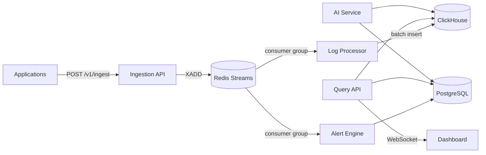

# Architecture

## Overview
Modular monolith in Go plus one separate Python AI service. Ingestion is decoupled from storage by a queue so bursts do not overload the database.



## Components
- **Ingestion API**: authenticates API key, validates batch, enforces size limits and stream backpressure (`429`), writes to Redis Stream, returns `202 Accepted`.
- **Log Processor** (`cmd/processor`): consumer group worker. Parses and validates entries, batches inserts into ClickHouse (by size or 1 s), acknowledges only after a successful write, dead-letters unusable entries. Fingerprinting comes later. See "Processor (v0.1)" below and ADR 0008.
- **Alert Engine**: evaluates rules on a sliding window; opens incidents and sends notifications.
- **Query API** (`cmd/query`): read-only REST search over ClickHouse (`GET /v1/logs`, v0.1); WebSocket live tail later. Always scoped by `project_id` through one query builder. See "Query API (v0.1 contract)" and ADR 0009.
- **AI Service**: anomaly detection and root-cause suggestions. Called by the backend over HTTP.
- **Dashboard**: React + TypeScript.

## Ingestion API (v0.1 contract)
```
POST /v1/ingest
X-API-Key: <project key>
Content-Type: application/json

{ "events": [
  { "timestamp": "2026-11-06T10:15:30.123Z", "level": "error", "service": "checkout",
    "message": "payment gateway timeout", "trace_id": "abc123",
    "attributes": { "env": "prod", "region": "eu-1" } } ] }
```
Responses (all bodies are JSON):

| Status | When | Body |
|--------|------|------|
| `202` | batch accepted | `{"accepted": N}` |
| `400` | malformed JSON, unknown field, trailing data, or an invalid event | `{"error": "events[3]: level must be one of ...", "index": 3}` (`index` only for per-event errors) |
| `401` | `X-API-Key` missing or wrong | `{"error": "missing or invalid API key"}` |
| `405` | method other than `POST` (`Allow: POST` is set) | `{"error": ...}` |
| `413` | body larger than the limit (by `Content-Length` or while reading) | `{"error": ...}` |
| `415` | `Content-Type` is not `application/json` (parameters such as `charset` are allowed) | `{"error": ...}` |
| `429` | backpressure: the stream backlog is at `INGEST_MAX_STREAM_LEN`; nothing was written. `Retry-After: 1` is set; retry with backoff | `{"error": "ingest queue is full, retry after the Retry-After delay"}` |
| `503` | the publisher (queue) failed, including Redis refusing writes at its memory cap; the client should retry | `{"error": "events could not be accepted, retry later"}` |

Checks run in this order: method, API key, content type, body size, then JSON and event validation. The batch is all-or-nothing: if any event is invalid nothing is published.

Validation rules:
- `timestamp` required, RFC3339 (fractional seconds and offsets allowed; stored as UTC).
- `level` required, one of `debug`, `info`, `warn`, `error`, `fatal` (lowercase).
- `service` and `message` required and non-blank. `trace_id` and `attributes` optional.
- `attributes` is a flat object of string values.

Limits (env var, default): body `INGEST_MAX_BODY_BYTES` 1 MiB; events per batch `INGEST_MAX_EVENTS` 1000; message `INGEST_MAX_MESSAGE_BYTES` 8 KiB; attributes per event `INGEST_MAX_ATTRIBUTES` 32; attribute key `INGEST_MAX_ATTR_KEY_CHARS` 64 characters; attribute value `INGEST_MAX_ATTR_VALUE_CHARS` 1024 characters; `trace_id` `INGEST_MAX_TRACE_ID_LEN` 128 characters.

Authentication in v0.1 is a single static key from `INGEST_API_KEY`, compared in constant time and never logged. Per-project hashed keys replace it in v0.2.

### Publishing (v0.1)
`PUBLISHER` selects where accepted events go:
- `memory` (default): bounded in-process buffer for tests and local runs. Events are lost on restart.
- `redis`: one `XADD <REDIS_STREAM> * ...` per event (no `MAXLEN`: publishing never trims), with the whole batch sent in one pipeline under `REDIS_TIMEOUT`. Any failure returns `503`. Delivery is at-least-once (see ADR 0007).

**Backpressure (ADR 0010).** The publisher refreshes a cached `XLEN` every 500 ms in the background. While the cached length is at or above `INGEST_MAX_STREAM_LEN` (500,000), requests get `429` with `Retry-After: 1` and nothing is written. The limit is soft: the stream can overshoot by about ingest rate × refresh interval plus in-flight batches (per ingest instance). The hard backstop is Redis `--maxmemory 1gb --maxmemory-policy noeviction`: a full Redis refuses `XADD` and ingest answers `503`, never `202`.

**Trimming (ADR 0010).** Only the processor trims, every `PROCESSOR_TRIM_INTERVAL` (5s), with exact `XTRIM MINID` at the minimum over all consumer groups of: the group's lowest pending ID, or the ID after its last-delivered ID when nothing is pending. Pending and undelivered entries are never removed, and every group (for example a future alerting group) holds trimming back. It does not trim when there are no groups, a group has read nothing, or the state cannot be read.

Stream entry (default stream `logsage:events`):

| Field | Value |
|-------|-------|
| `payload` | event JSON: `timestamp` (RFC3339, UTC), `level`, `service`, `message`, `trace_id` (omitted if empty), `attributes` (omitted if empty) |
| `project_id` | `"default"` until projects exist (v0.2) |
| `ingested_at` | server receive time, RFC3339 UTC with fractional seconds |

Config: `REDIS_ADDR` (required for `redis`), `REDIS_STREAM` (`logsage:events`), `REDIS_TIMEOUT` (`2s`), `INGEST_MAX_STREAM_LEN` (500000). `REDIS_STREAM_MAXLEN` was removed; setting it is a startup error.

### Health endpoints
- `GET /healthz`: liveness only, always `200 {"status":"ok"}` while the process serves HTTP.
- `GET /readyz`: `200 {"status":"ready"}`, or `503 {"status":"unavailable"}` when `PUBLISHER=redis` and Redis `PING` fails within `REDIS_TIMEOUT`. Failure details are logged, not returned.
- `GET /stats` (ingest, no key, no secrets): `{"accepted_total":N,"rejected_overload_total":N,"publish_errors_total":N,"stream_length_cached":N,"max_stream_len":500000}`. `accepted_total` counts events; the other two count requests. The last two fields are `null` with the memory publisher.

## Query API (v0.1 contract)
```
GET /v1/logs?from=2026-11-06T00:00:00Z&to=2026-11-06T12:00:00Z&level=error,fatal&service=checkout&q=timeout&limit=100
X-API-Key: <query key>
```
| Parameter | Rules |
|-----------|-------|
| `from`, `to` | Required, RFC3339. `from` inclusive, `to` exclusive, `from < to`, `to - from <= QUERY_MAX_WINDOW` (168h). Millisecond precision. |
| `level` | Optional, comma-separated subset of `debug,info,warn,error,fatal`. |
| `service` | Optional, exact match. |
| `q` | Optional, case-insensitive substring of `message` (UTF-8, at most `QUERY_MAX_TEXT_LEN` = 256 characters). |
| `trace_id` | Optional, exact match. |
| `limit` | Optional, 1..`QUERY_MAX_LIMIT` (1000), default 100. |
| `cursor` | Optional, `next_cursor` from the previous page of the same query, unchanged. |

Unknown or repeated parameters are rejected. Results are ordered newest first (`timestamp DESC, event_id DESC`) and deduplicated (`FINAL`).

`200`:
```json
{"events":[{"event_id":"1793993613811-0","timestamp":"2026-11-06T10:00:01.000Z","level":"info","service":"checkout",
  "message":"order created","trace_id":"t-1","attributes":{"env":"dev"}}],
 "next_cursor":"eyJ2IjoxLC...","took_ms":7}
```
`next_cursor` is `null` on the last page. Errors are `{"error":"..."}`: `400` (names the bad parameter), `401` (missing or wrong key, including the ingest key), `405` (not GET), `503` (ClickHouse unreachable or failing), `504` (query timed out), `500` (ClickHouse rejected the query). ClickHouse messages are never returned to clients.

Auth: `QUERY_API_KEY`, separate from `INGEST_API_KEY` (they must differ); constant-time comparison of SHA-256 digests, never logged.

Safety: every query is built by `query.Build`, which always adds `project_id = {project_id:String}` (`"default"` until v0.2). All values are server-side parameters (`{name:Type}` + `param_<name>`), never part of the SQL text. ClickHouse settings per query: `readonly=1`, `max_execution_time=QUERY_TIMEOUT` (10s), `max_result_rows=QUERY_MAX_LIMIT+1`.

Cost: queries without `service` read more of the primary index than queries with it (sorting key `(project_id, service, timestamp, event_id)`), and `q` scans every `message` in the time window. Both are bounded by `QUERY_MAX_WINDOW` and `QUERY_TIMEOUT` (ADR 0009).

Health: `GET /healthz` (liveness), `GET /readyz` (ClickHouse `/ping`). Listens on `QUERY_HTTP_ADDR` (`:8082`).

## Data model

### ClickHouse
Created by `backend/migrations/clickhouse` (applied idempotently by the processor on startup):
```sql
CREATE TABLE IF NOT EXISTS logsage.logs (
  project_id  LowCardinality(String),   -- "default" until projects exist (v0.2)
  event_id    String,                   -- Redis stream entry ID, used for deduplication
  timestamp   DateTime64(3, 'UTC'),
  level       LowCardinality(String),
  service     LowCardinality(String),
  message     String,
  fingerprint UInt64,                   -- 0 until fingerprinting lands
  trace_id    String,
  attributes  Map(String, String),
  ingested_at DateTime64(3, 'UTC') DEFAULT now64(3)
) ENGINE = ReplacingMergeTree
PARTITION BY toYYYYMMDD(timestamp)
ORDER BY (project_id, service, timestamp, event_id)
TTL toDateTime(timestamp) + INTERVAL 30 DAY;  -- CLICKHOUSE_TTL_DAYS
```
Delivery is at-least-once, so a redelivered entry can be inserted twice. Duplicates share the sorting key and collapse on merge. **Read with `FINAL`** (`SELECT ... FROM logs FINAL`) or dedupe by `event_id` when exact results matter.

## Processor (v0.1)
- Consumer group `logsage-processor` on `REDIS_STREAM`; consumer `PROCESSOR_CONSUMER` (default `hostname-pid`). The group is created at `0` with `MKSTREAM`.
- Loop: own pending entries first, then `XREADGROUP >` (`PROCESSOR_READ_COUNT`, `PROCESSOR_READ_BLOCK`), plus `XAUTOCLAIM` every `PROCESSOR_CLAIM_INTERVAL` for entries idle longer than `PROCESSOR_CLAIM_IDLE` (30s).
- Flush at `PROCESSOR_BATCH_SIZE` (1000) rows or `PROCESSOR_FLUSH_INTERVAL` (1s) as one `INSERT INTO logs FORMAT JSONEachRow` over HTTP (`CLICKHOUSE_URL`, port 8123), then `XACK`.
- Insert failure: no ack, no drop; retry with exponential backoff and jitter (`PROCESSOR_RETRY_INITIAL`..`PROCESSOR_RETRY_MAX`) and read nothing new meanwhile (backpressure shows up as stream lag).
- Unusable entries go to `PROCESSOR_DEAD_STREAM` (`logsage:events:dead`, capped at about `PROCESSOR_DEAD_MAXLEN` = 100000) with their original fields plus `original_id`, `reason` and `dead_lettered_at`, then get acked.
- Safe trimming of the main stream every `PROCESSOR_TRIM_INTERVAL` (see "Publishing" above). The consumer group is created even when Redis is at its memory cap (an `OOM` reply is accepted if `XINFO GROUPS` shows the group exists).
- Shutdown (SIGINT/SIGTERM): stop reading, flush and ack within `PROCESSOR_SHUTDOWN_TIMEOUT`.
- HTTP (`PROCESSOR_HTTP_ADDR`, default `:8081`): `GET /healthz` (liveness), `GET /readyz` (Redis `PING` and ClickHouse `/ping`), `GET /stats`:
  ```json
  {"stream_length":3,"group_pending":0,"group_lag":0,"oldest_unprocessed_age_s":0,"processed_total":3,"failed_batches_total":0,"dead_lettered_total":0,"trimmed_total":0}
  ```
  `failed_batches_total` counts failed insert attempts. `oldest_unprocessed_age_s` is the age of the oldest entry the group has not acknowledged (0 when caught up). Stream fields are `null` (with `stream_error`) when Redis is down. The same figures are logged every `PROCESSOR_STATS_INTERVAL` (10s), with a warning when `oldest_unprocessed_age_s` exceeds `PROCESSOR_LAG_WARN_AGE` (30s).

### PostgreSQL
Created by `backend/migrations/postgres` (hand-written SQL, applied by `cmd/admin migrate` with checksums and an advisory lock; ADR 0011):

```sql
projects (id uuid PK, name text, slug text UNIQUE CHECK (slug ~ '^[a-z0-9-]{3,40}$'),
          created_at timestamptz, disabled_at timestamptz NULL)
api_keys (id uuid PK, project_id uuid FK -> projects ON DELETE CASCADE,
          kind text CHECK (kind IN ('ingest','query')), name text,
          key_prefix text UNIQUE,      -- public lookup part
          key_hash bytea (32 bytes),   -- SHA-256 of the whole key; the key itself is never stored
          created_at, expires_at NULL, revoked_at NULL, last_used_at NULL)
schema_migrations (version, name, checksum, applied_at)
```
The project with slug `default` (id `00000000-0000-0000-0000-000000000001`) owns all v0.1 data: ClickHouse rows carry `project_id = 'default'`, its slug.

Planned: `users`, `alert_rules`, `error_groups`, `incidents`, `incident_events`, `deploy_events`.

### API key lifecycle (v0.2 package G)
- **Create:** `admin create-key --project SLUG --kind ingest|query --name N [--expires-in 720h]` generates `lsk_<ing|qry>_<8 base32 chars>_<43 base64url chars>` from `crypto/rand` (40-bit prefix, 256-bit secret), stores only prefix and SHA-256, and prints the key once.
- **Verify** (`keys.Verifier`): parse, look up by prefix, constant-time hash comparison, then kind, revocation, expiry and project status. Every rejection returns the same "invalid API key"; storage errors are distinct. `last_used_at` is written at most once per minute per key.
- **Revoke:** `admin revoke-key --prefix P` sets `revoked_at`; `admin disable-project --slug S` stops all keys of a project. Keys expire at `expires_at`.
- **Not yet wired:** ingest and query still use the static `INGEST_API_KEY` / `QUERY_API_KEY`; package H switches them to per-project keys.

## Fingerprinting
Normalize the message (strip numbers, UUIDs, hex, timestamps, paths), hash the normalized template plus service plus level. Same template = same error group. Refined later with similarity clustering.

## Agent integration (planned, v1.0)
LogSage exposes a stable REST API and outgoing webhooks so external agents can query logs, read incidents, and post actions. A Model Context Protocol (MCP) server wrapper is planned so LLM agents can use LogSage as a tool. Design implication: every capability must be available through the API, not only the UI.

## Risks
| Risk | Mitigation |
|------|------------|
| Ingestion bursts overload storage | Queue + batched inserts, soft backpressure `429` at `INGEST_MAX_STREAM_LEN` (ADR 0010) |
| Queued events lost before processing | No publish-time trimming; processor trims only what every group acknowledged; Redis `noeviction` memory cap turns overload into `503` (ADR 0010) |
| A stuck consumer fills Redis | `oldest_unprocessed_age_s` with a warning, `429` then `503`, never silent loss |
| High-cardinality attributes bloat ClickHouse | Attribute count/size limits, `Map` type, documented limits |
| Redelivery duplicates rows | `event_id` + `ReplacingMergeTree`, reads with `FINAL` (ADR 0008) |
| ClickHouse down or rejecting inserts | No ack, retry with backoff, backpressure into Redis; visible in `/stats` |
| Poisoned or oversized payloads | Size limits, strict validation, rate limit per key |
| Cross-project data leak | Mandatory `project_id` filter via a single query builder, tested (ADR 0009) |
| SQL injection through search parameters | Server-side query parameters only, `readonly=1`, injection tests |
| Expensive searches | Time-window, page-size and text-length limits, `max_execution_time`, `504` |
| False-positive anomalies | Start with simple statistical baselines, measure before adding ML |
