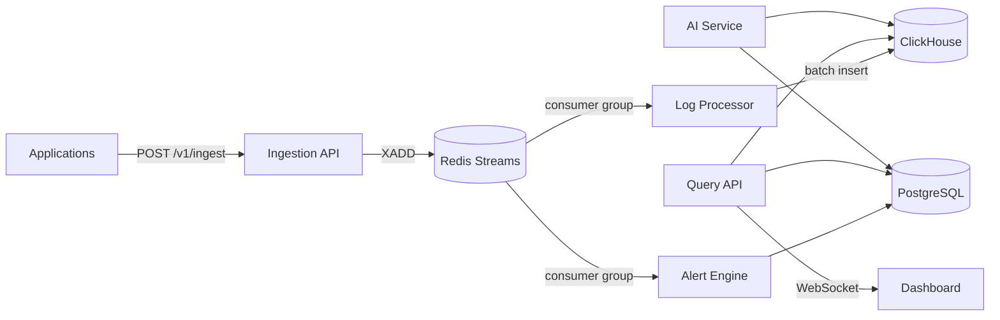

# Architecture

## Overview
Modular monolith in Go plus one separate Python AI service. Ingestion is decoupled from storage by a queue so bursts do not overload the database.



## Components
- **Ingestion API**: authenticates API key, validates batch, enforces rate limit and size limit, writes to Redis Stream, returns `202 Accepted`.
- **Log Processor**: consumer group worker. Parses, normalizes, computes fingerprint, batches inserts into ClickHouse (by size or 1 s), acknowledges only after a successful write.
- **Alert Engine**: evaluates rules on a sliding window; opens incidents and sends notifications.
- **Query API**: REST + WebSocket for the dashboard; always scoped by `project_id`.
- **AI Service**: anomaly detection and root-cause suggestions. Called by the backend over HTTP.
- **Dashboard**: React + TypeScript.

## Ingestion API (v0.1 contract)
```
POST /v1/ingest
X-API-Key: <project key>
Content-Type: application/json

{ "events": [
  { "timestamp": "2026-11-06T10:15:30.123Z", "level": "error", "service": "checkout",
    "message": "payment gateway timeout", "trace_id": "abc123",
    "attributes": { "env": "prod", "region": "eu-1" } } ] }
```
Responses (all bodies are JSON):

| Status | When | Body |
|--------|------|------|
| `202` | batch accepted | `{"accepted": N}` |
| `400` | malformed JSON, unknown field, trailing data, or an invalid event | `{"error": "events[3]: level must be one of ...", "index": 3}` (`index` only for per-event errors) |
| `401` | `X-API-Key` missing or wrong | `{"error": "missing or invalid API key"}` |
| `405` | method other than `POST` (`Allow: POST` is set) | `{"error": ...}` |
| `413` | body larger than the limit (by `Content-Length` or while reading) | `{"error": ...}` |
| `415` | `Content-Type` is not `application/json` (parameters such as `charset` are allowed) | `{"error": ...}` |
| `429` | rate limited (planned, not in v0.1 yet) | `{"error": ...}` |
| `503` | the publisher (queue) failed; the client should retry | `{"error": "events could not be accepted, retry later"}` |

Checks run in this order: method, API key, content type, body size, then JSON and event validation. The batch is all-or-nothing: if any event is invalid nothing is published.

Validation rules:
- `timestamp` required, RFC3339 (fractional seconds and offsets allowed; stored as UTC).
- `level` required, one of `debug`, `info`, `warn`, `error`, `fatal` (lowercase).
- `service` and `message` required and non-blank. `trace_id` and `attributes` optional.
- `attributes` is a flat object of string values.

Limits (env var, default): body `INGEST_MAX_BODY_BYTES` 1 MiB; events per batch `INGEST_MAX_EVENTS` 1000; message `INGEST_MAX_MESSAGE_BYTES` 8 KiB; attributes per event `INGEST_MAX_ATTRIBUTES` 32; attribute key `INGEST_MAX_ATTR_KEY_CHARS` 64 characters; attribute value `INGEST_MAX_ATTR_VALUE_CHARS` 1024 characters.

Authentication in v0.1 is a single static key from `INGEST_API_KEY`, compared in constant time and never logged. Per-project hashed keys replace it in v0.2. Until the Redis Streams producer lands, accepted events go to an in-memory publisher (bounded, lost on restart).

## Data model

### ClickHouse
```sql
CREATE TABLE logs (
  project_id  UUID,
  timestamp   DateTime64(3),
  level       LowCardinality(String),
  service     LowCardinality(String),
  message     String,
  fingerprint UInt64,
  trace_id    String,
  attributes  Map(String, String),
  ingested_at DateTime64(3) DEFAULT now64(3)
) ENGINE = MergeTree
PARTITION BY toYYYYMMDD(timestamp)
ORDER BY (project_id, service, timestamp)
TTL toDateTime(timestamp) + INTERVAL 30 DAY;
```

### PostgreSQL
`users`, `projects`, `api_keys` (hash only), `alert_rules`, `error_groups`, `incidents`, `incident_events`, `deploy_events`.

## Fingerprinting
Normalize the message (strip numbers, UUIDs, hex, timestamps, paths), hash the normalized template plus service plus level. Same template = same error group. Refined later with similarity clustering.

## Agent integration (planned, v1.0)
LogSage exposes a stable REST API and outgoing webhooks so external agents can query logs, read incidents, and post actions. A Model Context Protocol (MCP) server wrapper is planned so LLM agents can use LogSage as a tool. Design implication: every capability must be available through the API, not only the UI.

## Risks
| Risk | Mitigation |
|------|------------|
| Ingestion bursts overload storage | Queue + batched inserts, backpressure and `429` |
| High-cardinality attributes bloat ClickHouse | Attribute count/size limits, `Map` type, documented limits |
| Poisoned or oversized payloads | Size limits, strict validation, rate limit per key |
| Cross-project data leak | Mandatory `project_id` filter via a single query builder, tested |
| False-positive anomalies | Start with simple statistical baselines, measure before adding ML |
