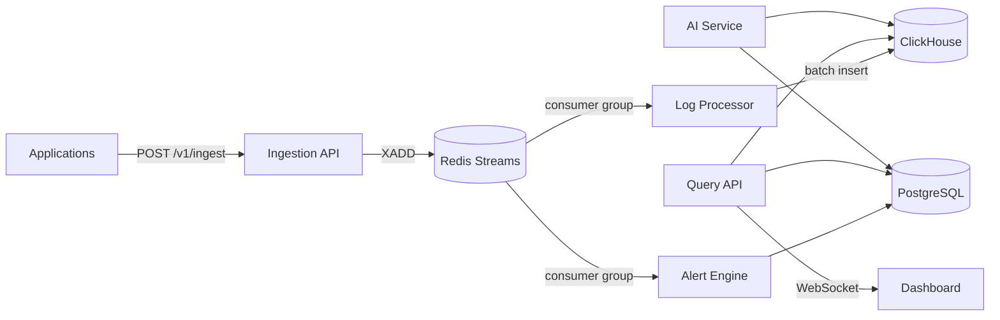

# Architecture

## Overview
Modular monolith in Go plus one separate Python AI service. Ingestion is decoupled from storage by a queue so bursts do not overload the database.



## Components
- **Ingestion API**: authenticates API key, validates batch, enforces size limits and stream backpressure (`429`), writes to Redis Stream, returns `202 Accepted`.
- **Log Processor** (`cmd/processor`): consumer group worker. Parses and validates entries, batches inserts into ClickHouse (by size or 1 s), acknowledges only after a successful write, dead-letters unusable entries. Fingerprinting comes later. See "Processor (v0.1)" below and ADR 0008.
- **Alerts** (`cmd/alerts`, v0.3 K1): evaluates alert rules over event-time windows through the shared query service, keeps their state in PostgreSQL and delivers signed webhook notifications through an outbox and an SSRF-safe client. One instance evaluates (advisory lock); see "Alerts (K1)" below and ADR 0024. Incidents come later (L).
- **Query API** (`cmd/query`): read-only REST search over ClickHouse (`GET /v1/logs`, v0.1); WebSocket live tail later. Always scoped by `project_id` through one query builder. See "Query API (v0.1 contract)" and ADR 0009.
- **AI Service**: anomaly detection and root-cause suggestions. Called by the backend over HTTP.
- **Management API** (`cmd/api`, v0.2): login with server-side sessions, projects, member roles and API keys over JSON. PostgreSQL only. See "Management API (v0.2 contract)" and ADR 0013.
- **Dashboard** (`frontend/`, v0.2 I2a): React + TypeScript single-page app (Vite) on the management API; session cookie only, state in the URL, untrusted text rendered as text only. In development Vite proxies `/api` to `cmd/api`; production serving and CSP are an open decision. See "Dashboard (v0.2)" and ADR 0016.

## Ingestion API (v0.1 contract)
```
POST /v1/ingest
X-API-Key: <project key>
Content-Type: application/json

{ "events": [
  { "timestamp": "2026-11-06T10:15:30.123Z", "level": "error", "service": "checkout",
    "message": "payment gateway timeout", "trace_id": "abc123",
    "attributes": { "env": "prod", "region": "eu-1" } } ] }
```
Responses (all bodies are JSON):

| Status | When | Body |
|--------|------|------|
| `202` | batch accepted | `{"accepted": N}` |
| `400` | malformed JSON, unknown field, trailing data, or an invalid event | `{"error": "events[3]: level must be one of ...", "index": 3}` (`index` only for per-event errors) |
| `401` | `X-API-Key` missing, wrong, revoked, expired, of a disabled project, or a query key | `{"error": "missing or invalid API key"}` |
| `503` (auth) | the key is not cached and PostgreSQL cannot verify it | `{"error": "authentication temporarily unavailable, retry later"}` |
| `405` | method other than `POST` (`Allow: POST` is set) | `{"error": ...}` |
| `413` | body larger than the limit (by `Content-Length` or while reading) | `{"error": ...}` |
| `415` | `Content-Type` is not `application/json` (parameters such as `charset` are allowed) | `{"error": ...}` |
| `429` | backpressure: the stream backlog is at `INGEST_MAX_STREAM_LEN`; nothing was written. `Retry-After: 1` is set; retry with backoff | `{"error": "ingest queue is full, retry after the Retry-After delay"}` |
| `503` | the publisher (queue) failed, including Redis refusing writes at its memory cap; the client should retry | `{"error": "events could not be accepted, retry later"}` |

Checks run in this order: method, API key, content type, body size, then JSON and event validation. The batch is all-or-nothing: if any event is invalid nothing is published.

Validation rules:
- `timestamp` required, RFC3339 (fractional seconds and offsets allowed; stored as UTC).
- `level` required, one of `debug`, `info`, `warn`, `error`, `fatal` (lowercase).
- `service` and `message` required and non-blank. `trace_id` and `attributes` optional.
- `attributes` is a flat object of string values.

Limits (env var, default): body `INGEST_MAX_BODY_BYTES` 1 MiB; events per batch `INGEST_MAX_EVENTS` 1000; message `INGEST_MAX_MESSAGE_BYTES` 8 KiB; attributes per event `INGEST_MAX_ATTRIBUTES` 32; attribute key `INGEST_MAX_ATTR_KEY_CHARS` 64 characters; attribute value `INGEST_MAX_ATTR_VALUE_CHARS` 1024 characters; `trace_id` `INGEST_MAX_TRACE_ID_LEN` 128 characters.

Authentication (v0.2 H1, ADR 0012): a per-project **ingest** key from PostgreSQL. The verified key decides the project: every event is stamped with the key's project id (UUID) and nothing in the body can set it. Deprecated static `INGEST_API_KEY` works only with `ALLOW_LEGACY_STATIC_KEYS=true` and maps to the default project.

### Publishing (v0.1)
`PUBLISHER` selects where accepted events go:
- `memory` (default): bounded in-process buffer for tests and local runs. Events are lost on restart.
- `redis`: one `XADD <REDIS_STREAM> * ...` per event (no `MAXLEN`: publishing never trims), with the whole batch sent in one pipeline under `REDIS_TIMEOUT`. Any failure returns `503`. Delivery is at-least-once (see ADR 0007).

**Backpressure (ADR 0010).** The publisher refreshes a cached `XLEN` every 500 ms in the background. While the cached length is at or above `INGEST_MAX_STREAM_LEN` (500,000), requests get `429` with `Retry-After: 1` and nothing is written. The limit is soft: the stream can overshoot by about ingest rate × refresh interval plus in-flight batches (per ingest instance). The hard backstop is Redis `--maxmemory 1gb --maxmemory-policy noeviction`: a full Redis refuses `XADD` and ingest answers `503`, never `202`.

**Trimming (ADR 0010).** Only the processor trims, every `PROCESSOR_TRIM_INTERVAL` (5s), with exact `XTRIM MINID` at the minimum over all consumer groups of: the group's lowest pending ID, or the ID after its last-delivered ID when nothing is pending. Pending and undelivered entries are never removed, and every group (for example a future alerting group) holds trimming back. It does not trim when there are no groups, a group has read nothing, or the state cannot be read.

Stream entry (default stream `logsage:events`):

| Field | Value |
|-------|-------|
| `payload` | event JSON: `timestamp` (RFC3339, UTC), `level`, `service`, `message`, `trace_id` (omitted if empty), `attributes` (omitted if empty) |
| `project_id` | `"default"` until projects exist (v0.2) |
| `ingested_at` | server receive time, RFC3339 UTC with fractional seconds |

Config: `REDIS_ADDR` (required for `redis`), `REDIS_STREAM` (`logsage:events`), `REDIS_TIMEOUT` (`2s`), `INGEST_MAX_STREAM_LEN` (500000). `REDIS_STREAM_MAXLEN` was removed; setting it is a startup error.

### Health endpoints
- `GET /healthz`: liveness only, always `200 {"status":"ok"}` while the process serves HTTP.
- `GET /readyz`: `200 {"status":"ready"}`, or `503 {"status":"unavailable"}` when `PUBLISHER=redis` and Redis `PING` fails within `REDIS_TIMEOUT`. Failure details are logged, not returned.
- `GET /stats` (ingest, no key, no secrets): `{"accepted_total":N,"rejected_overload_total":N,"publish_errors_total":N,"stream_length_cached":N,"max_stream_len":500000}`. `accepted_total` counts events; the other two count requests. The last two fields are `null` with the memory publisher.

## Query API (v0.1 contract)
```
GET /v1/logs?from=2026-11-06T00:00:00Z&to=2026-11-06T12:00:00Z&level=error,fatal&service=checkout&q=timeout&limit=100
X-API-Key: <query key>
```
| Parameter | Rules |
|-----------|-------|
| `from`, `to` | Required, RFC3339. `from` inclusive, `to` exclusive, `from < to`, `to - from <= QUERY_MAX_WINDOW` (168h). Millisecond precision. |
| `level` | Optional, comma-separated subset of `debug,info,warn,error,fatal`. |
| `service` | Optional, exact match; or a comma-separated list of up to 20 names (any of them, sent as one `Array(String)` parameter). A comma always separates names. |
| `q` | Optional, case-insensitive substring of `message` (UTF-8, at most `QUERY_MAX_TEXT_LEN` = 256 characters). |
| `trace_id` | Optional, exact match. |
| `fingerprint` | Optional, 16 hexadecimal characters: rows of one error group (ADR 0022). Each event also carries a `fingerprint` field, empty when not grouped. |
| `limit` | Optional, 1..`QUERY_MAX_LIMIT` (1000), default 100. |
| `cursor` | Optional, `next_cursor` from the previous page of the same query, unchanged. |

Unknown or repeated parameters are rejected. Results are ordered newest first (`timestamp DESC, event_id DESC`) and deduplicated (`FINAL`).

`200`:
```json
{"events":[{"event_id":"1793993613811-0","timestamp":"2026-11-06T10:00:01.000Z","level":"info","service":"checkout",
  "message":"order created","trace_id":"t-1","attributes":{"env":"dev"}}],
 "next_cursor":"eyJ2IjoxLC...","took_ms":7}
```
`next_cursor` is `null` on the last page. Errors are `{"error":"..."}`: `400` (names the bad parameter), `401` (missing or wrong key, including the ingest key), `405` (not GET), `503` (ClickHouse unreachable or failing), `504` (query timed out), `500` (ClickHouse rejected the query). ClickHouse messages are never returned to clients.

Auth (ADR 0012): a per-project **query** key; the project comes only from the key (a `project_id` parameter is rejected). `401` for bad keys, `503` when PostgreSQL cannot verify an uncached key. Deprecated static `QUERY_API_KEY` (default project, only with `ALLOW_LEGACY_STATIC_KEYS=true`).

Safety: every query is built in `internal/query` (`Build` and the histogram and facet builders share one `where()`; ADR 0014), which always starts with `(project_id = {project_id:String} OR project_id = {project_alias:String})`: the key's project UUID, and as alias the legacy `"default"` for the default project (otherwise the UUID again). All values are server-side parameters (`{name:Type}` + `param_<name>`), never part of the SQL text. ClickHouse settings per query: `readonly=1`, `max_execution_time=QUERY_TIMEOUT` (10s), `max_result_rows=QUERY_MAX_LIMIT+1`.

Cost: queries without `service` read more of the primary index than queries with it (sorting key `(project_id, service, timestamp, event_id)`), and `q` scans every `message` in the time window. Both are bounded by `QUERY_MAX_WINDOW` and `QUERY_TIMEOUT` (ADR 0009).

Health: `GET /healthz` (liveness), `GET /readyz` (ClickHouse `/ping`). Listens on `QUERY_HTTP_ADDR` (`:8082`).

## Data model

### ClickHouse
Created by `backend/migrations/clickhouse` (applied idempotently by the processor on startup):
```sql
CREATE TABLE IF NOT EXISTS logsage.logs (
  project_id  LowCardinality(String),   -- "default" until projects exist (v0.2)
  event_id    String,                   -- Redis stream entry ID, used for deduplication
  timestamp   DateTime64(3, 'UTC'),
  level       LowCardinality(String),
  service     LowCardinality(String),
  message     String,
  fingerprint UInt64,                   -- error group (ADR 0022); 0 = not grouped
  template    String,                   -- normalized first line, '' when not grouped (migration 0005)
  trace_id    String,
  attributes  Map(String, String),
  ingested_at DateTime64(3, 'UTC') DEFAULT now64(3),
  inserted_at DateTime64(3, 'UTC') DEFAULT toDateTime64(0, 3, 'UTC'),  -- set by the processor per insert attempt (ADR 0015)
  INDEX idx_inserted_at inserted_at TYPE minmax GRANULARITY 1,
  INDEX idx_fingerprint fingerprint TYPE bloom_filter(0.01) GRANULARITY 4   -- migration 0006
) ENGINE = ReplacingMergeTree
PARTITION BY toYYYYMMDD(timestamp)
ORDER BY (project_id, service, timestamp, event_id)
TTL toDateTime(timestamp) + INTERVAL 30 DAY;  -- CLICKHOUSE_TTL_DAYS
```
Error groups (ADR 0022): `group_seen` (AggregatingMergeTree, migration 0007) keeps all-time first and last seen per `(project_id, fingerprint)` as `SimpleAggregateFunction(min|max)`, with a TTL on `last_seen` equal to the log retention. The materialized view `group_seen_mv` (0008) fills it from `logs` for rows with `fingerprint != 0`. Duplicates do not change `min`/`max`; counts always come from `logs FINAL`.

Delivery is at-least-once, so a redelivered entry can be inserted twice. Duplicates share the sorting key and collapse on merge. **Read with `FINAL`** (`SELECT ... FROM logs FINAL`) or dedupe by `event_id` when exact results matter.

## Processor (v0.1)
- Consumer group `logsage-processor` on `REDIS_STREAM`; consumer `PROCESSOR_CONSUMER` (default `hostname-pid`). The group is created at `0` with `MKSTREAM`.
- Loop: own pending entries first, then `XREADGROUP >` (`PROCESSOR_READ_COUNT`, `PROCESSOR_READ_BLOCK`), plus `XAUTOCLAIM` every `PROCESSOR_CLAIM_INTERVAL` for entries idle longer than `PROCESSOR_CLAIM_IDLE` (30s).
- Fingerprint at parse time, before the flush (ADR 0022): `warn`, `error` and `fatal` rows get `fingerprint` and `template` (see Fingerprinting); other rows keep `0` and `''`.
- Flush at `PROCESSOR_BATCH_SIZE` (1000) rows or `PROCESSOR_FLUSH_INTERVAL` (1s) as one `INSERT INTO logs FORMAT JSONEachRow` over HTTP (`CLICKHOUSE_URL`, port 8123), then `XACK`.
- Insert failure: no ack, no drop; retry with exponential backoff and jitter (`PROCESSOR_RETRY_INITIAL`..`PROCESSOR_RETRY_MAX`) and read nothing new meanwhile (backpressure shows up as stream lag).
- Unusable entries go to `PROCESSOR_DEAD_STREAM` (`logsage:events:dead`, capped at about `PROCESSOR_DEAD_MAXLEN` = 100000) with their original fields plus `original_id`, `reason` and `dead_lettered_at`, then get acked.
- Safe trimming of the main stream every `PROCESSOR_TRIM_INTERVAL` (see "Publishing" above). The consumer group is created even when Redis is at its memory cap (an `OOM` reply is accepted if `XINFO GROUPS` shows the group exists).
- Shutdown (SIGINT/SIGTERM): stop reading, flush and ack within `PROCESSOR_SHUTDOWN_TIMEOUT`.
- HTTP (`PROCESSOR_HTTP_ADDR`, default `:8081`): `GET /healthz` (liveness), `GET /readyz` (Redis `PING` and ClickHouse `/ping`), `GET /stats`:
  ```json
  {"stream_length":3,"group_pending":0,"group_lag":0,"oldest_unprocessed_age_s":0,"processed_total":3,"failed_batches_total":0,"dead_lettered_total":0,"trimmed_total":0}
  ```
  `failed_batches_total` counts failed insert attempts. `oldest_unprocessed_age_s` is the age of the oldest entry the group has not acknowledged (0 when caught up). Stream fields are `null` (with `stream_error`) when Redis is down. The same figures are logged every `PROCESSOR_STATS_INTERVAL` (10s), with a warning when `oldest_unprocessed_age_s` exceeds `PROCESSOR_LAG_WARN_AGE` (30s).

### PostgreSQL
Created by `backend/migrations/postgres` (hand-written SQL, applied by `cmd/admin migrate` with checksums and an advisory lock; ADR 0011):

```sql
projects (id uuid PK, name text, slug text UNIQUE CHECK (slug ~ '^[a-z0-9-]{3,40}$'),
          created_at timestamptz, disabled_at timestamptz NULL)
api_keys (id uuid PK, project_id uuid FK -> projects ON DELETE CASCADE,
          kind text CHECK (kind IN ('ingest','query')), name text,
          key_prefix text UNIQUE,      -- public lookup part
          key_hash bytea (32 bytes),   -- SHA-256 of the whole key; the key itself is never stored
          created_at, expires_at NULL, revoked_at NULL, last_used_at NULL)
schema_migrations (version, name, checksum, applied_at)
```
The project with slug `default` (id `00000000-0000-0000-0000-000000000001`) owns all v0.1 data: ClickHouse rows carry `project_id = 'default'`, its slug.

Migration 0002 (ADR 0013):

```sql
users (id uuid PK, email text, password_hash text CHECK (LIKE '$argon2id$%'),  -- PHC string
       created_at, disabled_at NULL)                    -- UNIQUE INDEX on lower(email)
sessions (id uuid PK, user_id FK -> users, token_hash bytea (32) UNIQUE,     -- SHA-256 of the cookie token
          created_at, last_seen_at, idle_expires_at, absolute_expires_at, revoked_at NULL,
          user_agent text (<= 256))                     -- indexes: active sessions per user, absolute_expires_at
project_members (project_id FK, user_id FK, role text CHECK (role IN ('owner','admin','viewer')),
                 created_at, PRIMARY KEY (project_id, user_id))           -- index on user_id
projects.created_by uuid NULL FK -> users ON DELETE SET NULL
audit_log (id bigint identity PK, at, user_id NULL FK, action text, target text, detail text)  -- never secrets
```
The default project has no members; assign an owner with `admin add-member --project default --email E --role owner`.

Migration 0003 (ADR 0022):

```sql
error_groups (project_id uuid FK -> projects ON DELETE CASCADE, fingerprint bigint CHECK (<> 0),  -- uint64 bits
              status text CHECK (IN ('open','ignored','resolved')), resolved_at NULL,  -- set iff resolved
              note text (<= 500), updated_by uuid NULL FK -> users, updated_at,
              PRIMARY KEY (project_id, fingerprint))
```
No row means `open`. A status change upserts the row and writes an `audit_log` row (`group.status`) in one transaction.

Migration 0007 (ADR 0026): `incidents` (per-project `number` from `incident_counters`, status, severity, assignee, services, `version`, `all_alerts_resolved`), `incident_alerts` (rule and state key per incident, closed with a reason), `incident_groups` (auto or manual), `incident_events` (a closed list of types, payloads with ids and templates only, a separate comment `body`, flapping `count`), and `open_incident`/`incident_severity` on `alert_rules`.

Migration 0004 (ADR 0024): `notification_channels` (URL and signing secret sealed with AES-256-GCM, `url_host` for display), `alert_rules` (type, `params` jsonb, interval, window, for, clear_for, repeat, `version`, `next_eval_at`), `alert_rule_channels`, `alert_states` (one row per rule and dedup key, optimistic `version`), `alert_events` (every transition, kept when the rule is deleted) and `alert_notifications` (the outbox: status, attempts, `next_attempt_at`, lease, unique `idempotency_key`, payload without secrets).

Planned: `incidents`, `incident_events`, `deploy_events`.

### API key lifecycle (v0.2 package G)
- **Create:** `admin create-key --project SLUG --kind ingest|query --name N [--expires-in 720h]` generates `lsk_<ing|qry>_<8 base32 chars>_<43 base64url chars>` from `crypto/rand` (40-bit prefix, 256-bit secret), stores only prefix and SHA-256, and prints the key once.
- **Verify** (`keys.Verifier`): parse, look up by prefix, constant-time hash comparison, then kind, revocation, expiry and project status. Every rejection returns the same "invalid API key"; storage errors are distinct. `last_used_at` is written at most once per minute per key.
- **Revoke:** `admin revoke-key --prefix P` sets `revoked_at`; `admin disable-project --slug S` stops all keys of a project. Keys expire at `expires_at`.
- **Use (H1, ADR 0012):** ingest and query verify keys through one authenticator with a bounded cache keyed by SHA-256 (`AUTH_CACHE_TTL` 30s, `AUTH_NEGATIVE_TTL` 5s, `AUTH_CACHE_SIZE` 10000). A revoked key or disabled project can keep working for up to `AUTH_CACHE_TTL`. PostgreSQL down + uncached key → `503`.

### Auth flow (H1)
```
X-API-Key ──> legacy static key? (only with ALLOW_LEGACY_STATIC_KEYS) ──> default project
          └─> cache[SHA-256(key)+kind] hit? ──> valid: principal / rejected: 401
          └─> one lookup per key: keys.Verifier (prefix -> hash compare -> kind, revoked, expired, project)
                 ok -> cache 30s -> principal{project_id}     invalid -> cache 5s -> 401     DB error -> 503 (not cached)
principal.project_id ──> ingest: stream entry project_id ──> processor ──> ClickHouse logs.project_id
                     └─> query: Scope{project_id, alias} ──> query.Build
```

## Management API (v0.2 contract)
`cmd/api`, default `:8083` (`API_HTTP_ADDR`). JSON bodies only, at most 16 KiB, unknown fields rejected. Every response has `Cache-Control: no-store` and `X-Content-Type-Options: nosniff`; errors are generic (`{"error":"unauthorized"}`).

| Method and path | Who | Result |
|---|---|---|
| `POST /api/auth/login` `{email,password}` | anyone | `200 {user}` + session cookie; `401` for any bad credential; `429` + `Retry-After` when throttled |
| `POST /api/auth/register` `{email,password}` | anyone, only with `REGISTRATION_ENABLED=true` | `201 {user}`; `404` when disabled; `409` duplicate |
| `POST /api/auth/logout`, `/logout-all` | session | `204`, cookie cleared; logout-all revokes every session of the user |
| `GET /api/auth/me` | session | `200 {user, session}` |
| `POST /api/auth/change-password` `{current_password,new_password}` | session | `204`, other sessions revoked; `403` wrong current |
| `GET /api/projects` / `POST /api/projects` `{name,slug}` | session | own projects with role / `201`, creator becomes owner |
| `GET /api/projects/{slug}` | member | `200 {project}` |
| `POST /api/projects/{slug}/disable` | owner | `200` |
| `GET /api/projects/{slug}/keys` | member | prefix, kind, name, dates, status; never hashes |
| `POST /api/projects/{slug}/keys` `{kind,name,expires_in?}` | owner, admin | `201 {key, info}`; the key is shown once |
| `POST /api/projects/{slug}/keys/{prefix}/revoke` | owner, admin | `200 {info}` |
| `GET /api/projects/{slug}/logs` | member | the `/v1/logs` search for this project (see below) |
| `GET /api/projects/{slug}/histogram` | member | counts per time bucket and level |
| `GET /api/projects/{slug}/facets` | member | counts per level and per service |

Non-members get `404` on every project endpoint (never `403`); members without the right get `403`. Unauthenticated, expired, revoked or disabled-user sessions get `401`; PostgreSQL errors `503`. `/healthz`, `/readyz` (PostgreSQL and ClickHouse).

Request checks, in order: CORS (only listed `ALLOWED_ORIGINS`, with credentials; preflight GET/POST), CSRF for every non-GET (JSON content type, also without a body, and a trusted `Origin`/`Referer`, else `403 {"error":"csrf: rejected by the browser security check"}`; a missing role is `403 {"error":"forbidden"}`), body limit, session, membership, role.

```
login ──> limiter(IP, sha256(email)) ──429──> Retry-After
      └─> user by email ── unknown ──> dummy argon2id verify ──> 401
      └─> argon2id verify (semaphore) ── wrong / disabled ──> 401 (+ audit, limiter)
      └─> rehash if parameters changed ──> new session row (token hash) ──> Set-Cookie ──> 200
request ──> cookie ──> SHA-256 ──> sessions JOIN users ──> revoked / expired / disabled ──> 401
                                                    └─> touch at most once a minute ──> handler
```

### Dashboard read endpoints (v0.2 package I1, ADR 0014)
Session cookie, any member role. Order: membership (`404` for non-members and unknown slugs, before parameters are read), parameters (`400` with the `/v1/logs` messages), per-user cap (`API_MAX_CONCURRENT_QUERIES`, default 4, else `429` + `Retry-After: 1`), query. Errors use the `/v1/logs` statuses and messages; ClickHouse text is never returned. All three use the shared `query.Service`: the same `QUERY_*` limits, the same project scope (the member's project; the default project also matches legacy `"default"` rows), `FINAL`, `readonly=1`.

| Endpoint | Parameters | `200` body |
|---|---|---|
| `logs` | as `/v1/logs`: `from`, `to`, `level`, `service`, `q`, `trace_id`, `limit`, `cursor` | `{"events":[...],"next_cursor":...,"took_ms":N}` |
| `histogram` | `from`, `to`, `level`, `service`, `q`, `trace_id`, optional `bucket` (`10s`, `30s`, `1m`, `5m`, `15m`, `1h`, `6h`, `1d`) | `{"bucket_seconds":N,"buckets":[{"t":"2026-11-07T10:07:00Z","debug":n,"info":n,"warn":n,"error":n,"fatal":n}],"took_ms":N}` |
| `facets` | `from`, `to`, `level`, `service`, `q`, `trace_id` | `{"total":n,"levels":{"debug":n,...},"services":[{"name":"payments","count":n}],"took_ms":N}` |

- Histogram: without `bucket` the smallest size giving at most 240 buckets; an explicit `bucket` may give at most 500. Buckets are aligned to the Unix epoch, cover the bucket holding `from` up to `to`, and empty ones are zero.
- Facets: level counts apply every filter except `level`, service counts every filter except `service`, `total` every filter. At most 50 services by count, then `{"name":"other","count":n,"other":true}`.

All three, and `tail`, also take the `fingerprint` filter.

### Error groups (v0.3 package J1, ADR 0022)
Same order, limits, errors and per-user cap as the read endpoints above.

| Endpoint | Parameters | `200` body |
|---|---|---|
| `GET groups` | `from`, `to`, `level`, `service`, `q` (on the template), `status` (`open`, `ignored`, `resolved`), `sort` (`count`, `last_seen`, `first_seen`), `limit` (default 50, at most 100), `cursor` (at most 1,000 groups deep, bound to its query) | `{"groups":[{"fingerprint","title","sample","error_type","levels","services","count","first_seen","last_seen","sparkline":[24],"status","resolved_at","is_new","regressed"}],"next_cursor":...,"sparkline_bucket_seconds":N,"took_ms":N}` |
| `GET groups/{fingerprint}` | `from`, `to` | the group plus `counts` (`[{"service","level","count"}]`), `series` (the `/histogram` bucket rules), the latest 5 `samples`, `note`, `updated_by`; `404` for an unknown group |
| `POST groups/{fingerprint}/status` | `{"status":"open|ignored|resolved","note":"..."}` (note at most 500 characters); owner and admin, viewers `403` | `{"group":{"fingerprint","status","resolved_at","note","updated_by","updated_at"}}`; `404` for a group the project has not seen |

`count` is the window count from `logs FINAL` and equals `/logs` with the same `fingerprint`. `first_seen` and `last_seen` are all-time (`group_seen`). `is_new`: first seen inside the window. `regressed`: resolved and seen after `resolved_at`. Rows with `fingerprint = 0` never form a group.

### Live tail (v0.2 package I1b, ADR 0015)
`GET /api/projects/{slug}/tail?level=&service=&q=&trace_id=`: session cookie, any member role. There is no `from`/`to`; the stream starts now. Request checks are those of the read endpoints: non-members and unknown slugs get `404`, no cookie gets `401`, bad parameters or an invalid `Last-Event-ID` get `400`. Above `TAIL_MAX_CONN_USER` (2), `TAIL_MAX_CONN_PROJECT` (10) or `TAIL_MAX_CONN_TOTAL` (50) open streams the answer is `429` with `Retry-After`.

Response: `200`, `Content-Type: text/event-stream`, `Cache-Control: no-store`, `X-Accel-Buffering: no`; it begins with `retry: 5000`.

| Event | `data` | Notes |
|---|---|---|
| `log` | one event, the same object as in `/logs` `events` | `id` is an opaque cursor; send it back as `Last-Event-ID` |
| `status` | `{"state":"live"}`, `{"state":"degraded","reason":"storage_unavailable"}`, `{"state":"closed","reason":"max_duration\|shutdown\|session_ended\|access_revoked"}` | heartbeat `{"state":...,"heartbeat":true}` every `TAIL_HEARTBEAT` (15s) |
| `reset` | `{"reason":"cursor_too_old\|overloaded"}` | refetch with `/logs`; the stream continues from now |

How the stream works:
- **Order:** rows are delivered in visibility order `(inserted_at, event_id)`.
- **Late rows:** rows that become visible late within `TAIL_OVERLAP` (30s) are still delivered.
- **Duplicates:** each event id is delivered once per stream.
- **Old events:** logs with an event time older than `TAIL_MAX_LATENESS` (10m) at arrival are not streamed live.
- **Resume:** a reconnect with `Last-Event-ID` within `TAIL_MAX_REPLAY` (5m) resumes without gaps or duplicates.
- **Stream lifetime:** a stream closes after `TAIL_MAX_DURATION` (1h). Session and membership are re-checked every `TAIL_AUTH_RECHECK` (30s), and a client slower than `TAIL_WRITE_TIMEOUT` per write is dropped.

### Alerts (K1, ADR 0024)
Session auth under `/api/projects/{slug}/alerts`; viewers read, owners and admins write, non-members get 404, every write leaves an audit row (no URLs or secrets). With `ALERTS_ENABLED=false`, or without a usable `ALERTS_SECRET_KEY`, the endpoints answer 503 with the reason.

| Endpoint | Purpose |
|---|---|
| `GET`/`POST rules`, `GET`/`PUT`/`DELETE rules/{id}`, `POST rules/{id}/enable` and `/disable` | Rules. Body: `name`, `note`, `type`, `params`, `interval`, `window`, `for`, `clear_for`, `repeat` (durations such as `30s`, `5m`), `enabled`, `channels` (1–10 ids). |
| `GET`/`POST channels`, `GET`/`PUT`/`DELETE channels/{id}`, `POST channels/{id}/rotate-secret` | Channels: `name`, `kind` (`webhook` or `slack`), `url` (checked by the SSRF rules), `include_sample`. The webhook signing secret appears only in the create and rotate responses. |
| `POST channels/{id}/test` | A test delivery (`alert.test`, `"test": true`), at most 5 per channel per 10 minutes (429 with `Retry-After`). |
| `GET states`, `GET events?rule=&before=&limit=`, `GET notifications?channel=&rule=&status=&before=&limit=` | Pending and firing states, transitions and the delivery history (each delivery with its `rule_id` and `rule_name`), newest first (`next_before` pages). Rule reads carry a state summary: `state` (ok, pending, firing or resolved), `firing`, `pending` and `last_change_at`, and the evaluator's heartbeat `last_evaluated_at` and `last_eval_error` (`query_timeout`, `query_rejected`, `store_unavailable`, `unknown` or empty). |

**Rule types:** `error_rate` (error and fatal share of the window, with `min_logs`), `log_volume` (`above` or `below` a count; below 1 is silence), `new_group` (first seen in the window with `min_events`; once per group), `regression` (a resolved group seen again; once per resolution), `new_groups_per_hour` (guard against group explosions). Limits: interval 30 s–1 h, window 1 min–24 h, 50 rules and 10 channels per project.

**Evaluation (`cmd/alerts`):** every `ALERTS_TICK` the instance holding the PostgreSQL advisory lock evaluates due rules (at most `ALERTS_QUERIES_PER_CYCLE`, `ALERTS_CONCURRENCY` at a time) over `[now - lateness - window, now - lateness)` in event time (`ALERTS_LATENESS`, default 60 s). Queries go through `query.Service` (project scope, `readonly`, time and row limits, `log_comment = 'alerts'`). States move ok → pending (`for`) → firing → resolved (after `clear_for` outside a hysteresis band); `repeat` re-notifies. A rule disabled or deleted while firing sends a final `alert.resolved` with `reason`. Health on `ALERTS_HTTP_ADDR` (`:8084`): `/healthz`, `/readyz`, `/stats`.

**Delivery:** the outbox is claimed with `FOR UPDATE SKIP LOCKED`; retries back off from 10 s, doubling with jitter, up to `ALERTS_MAX_ATTEMPTS`; at most `ALERTS_CHANNEL_RATE` sends per channel per minute. Webhooks carry `X-LogSage-Event`, `X-LogSage-Delivery` (idempotency key) and `X-LogSage-Signature: t=<unix>,v1=<hex HMAC-SHA256 over "t.body">`; Slack gets an escaped `{"text": ...}`. The client allows only https to public addresses (every DNS answer checked, the checked address dialed, no redirects, proxies, cookies, keep-alive or zones; TLS 1.2+ verified). A failure is kept as the status code and an `error_category` from a closed list; a receiver's response body is read, bounded, and discarded, never stored, logged or shown.

### Incidents (L1, ADR 0026)
Session auth under `/api/projects/{slug}/incidents`; viewers read, owners and admins write, non-members get 404, every change leaves an audit row without user text. Titles, summaries and comments are plain text.

| Endpoint | Purpose |
|---|---|
| `GET` (`status`, `severity`, `assignee=me|none|<id>`, `service`, `from`, `to`, `q`, `cursor`, `limit`), `GET summary`, `POST` | List (most recently active first; each row with `alert_count` and `group_count`), counts per status, manual create\|none\|<id>`, `service`, `from`, `to`, `q`, `cursor`, `limit`), `GET summary`, `POST` | List (most recently active first), counts per status, manual create (`title`, `severity`, `summary`, `services`, `assignee`). |
| `GET {number}`, `GET {number}/events?before=&limit=` | The incident with linked alerts and groups, `suggested_groups` (top 5 error groups of its services and window, never linked automatically, no samples) and the first timeline page; more timeline pages. |
| `PATCH {number}`, `POST {number}/acknowledge`, `/resolve`, `/reopen` | Title, severity and summary, or the status, each with `version` (409 when stale); a status change may carry a `note` (a comment). |
| `POST {number}/assign` (`user_id`), `/unassign`, `POST {number}/comments`, `DELETE {number}/comments/{id}`, `POST`/`DELETE {number}/groups/{fingerprint}` | Assignee (a project member), comments (never notify a channel), group links (at most 50). |
| `GET /api/projects/{slug}/members` | Members' `user_id`, `email` and `role`, for picking an assignee (read only; changes stay in the admin CLI). |

**Opening and grouping:** for a rule with `open_incident`, each transition into firing is correlated in the evaluator's `ApplyOutcome` transaction, under a per-project advisory lock.
- **Order:** an incident already linked to the rule and key; else an open incident active within `INCIDENT_MERGE_WINDOW` (30 m) that shares a service; project-wide rules only with project-wide incidents; else reopen the rule and key's incident if it was resolved within `INCIDENT_REOPEN_WINDOW` (60 m); else a new incident, marked as a recurrence when there was an earlier one.
- **Resolving:** there is no automatic resolve. Resolved states close their links and set `all_alerts_resolved`. A disabled, deleted or reset rule closes them with `alert_closed` and the reason.
- **Payload:** firing, repeat and resolved notifications of linked alerts carry `incident: {id, number, url}`, inside the signed body.
- **Limits:** 1000 open incidents per project (the automatic path then links nothing), 1000 events per incident. Resolved incidents older than `INCIDENT_RETENTION` (400 days) are deleted.

## Dashboard (v0.2)
`frontend/`, ADR 0016.

**Serving (ADR 0021):**
- `cmd/api` serves the built dashboard from `internal/web`, embedded at build time; the Docker frontend stage fills `backend/internal/web/dist`.
- Routes: `/api/*`, `/healthz`, `/readyz` and `/config.json` have their own handlers. The dashboard is the catch-all: GET and HEAD only, `index.html` for extension-less paths, a plain 404 for missing files and traversal attempts, and a JSON 404 for unknown `/api/` paths.
- Caching: `/assets/*` is cached for a year as immutable, `index.html` gets `no-cache`, and API responses and `/config.json` get `no-store`.
- Settings: `WEB_ENABLED` (default true) and `PUBLIC_INGEST_URL` (served as `/config.json`, read by the dashboard before it renders).
- Every response carries the security headers; HTML gets the strict CSP, and HSTS is sent only with `COOKIE_SECURE=true`.
- In development the Vite dev server proxies `/api` and `/config.json` instead.

Routes:
- `/login`: sign-in. A `next=<path>` parameter returns the user to that path afterwards; only same-app paths are accepted.
- `/`: opens the first project, or shows the empty state with a create-project form.
- `/projects/:slug/logs`: the log explorer (I2b, ADR 0017).
  - Live tail (I2c-2, ADR 0019): `live=1` streams `/tail` through a fetch-based SSE client (Last-Event-ID, backoff 5 s doubling to 30 s, 401/404/400 stop, 429 waits Retry-After), batches rows per frame, caps the list at 1,000 and pauses while the reader is busy.
  - URL state: `range` or `from`/`to` (UTC), plus `level`, `service`, `q` and `trace_id`.
  - Layout: a two-strip SVG timeline with brushing, the facets column, and single-line rows with Load more (de-duplicated, capped at 1,000).
  - Data: it calls `/histogram` for the context window, and `/facets` and `/logs` for the selected range; changing a filter cancels requests in flight.
  - Row detail and zoom (I2c-1, ADR 0018): an expanded row lazily calls `/logs?trace_id=...&limit=50` for 10 minutes around the log (Same trace), cancelled on collapse. `zoom=1` (absolute ranges only) makes the timeline's window the selection itself. Filter chips and the narrow-screen Filters disclosure are client-side only.
- `/projects/:slug/keys`: API keys (I2c-2, ADR 0019): list for every member; owners and admins create (one-time reveal kept only in component state) and revoke.

The app uses `/api/auth/login`, `/logout` and `/me`, `GET/POST /api/projects`, and the explorer endpoints `/logs`, `/histogram` and `/facets`; The live tail uses `/tail` (I2c-2); the keys screen uses `GET/POST /api/projects/{slug}/keys` and `POST .../keys/{prefix}/revoke`; the account menu uses `/api/auth/change-password`, `/logout-all` and `/logout`.

Error handling:
- A 401 on any signed-in request clears the cache and goes to `/login?next=...&expired=1`.
- A 429 shows the `Retry-After` seconds.
- 400 errors show the server's fixed message.
- 404, 5xx and network errors become plain messages that say how to fix the problem.

Nothing is kept in browser storage. Log text goes through `<LogText>` (text nodes only); `dangerouslySetInnerHTML` and `innerHTML` are lint errors.

## Fingerprinting
Package `internal/fingerprint` (ADR 0022, version `"1"`). Only `warn`, `error` and `fatal` are grouped.
- **Template:** the first line (for a Python traceback, its exception line), cut to 512 bytes, normalized by ordered RE2 rules (HTTP versions, HTTP statuses, exit codes, signals and SQLSTATE codes protected; timestamps, UUIDs, emails, URLs, pod names, IPs, path segments, tokens, hex, units, prefixed ids, mixed ids and numbers become placeholders such as `<n>`, `<id>`, `<uuid>`, `<ts>`), run to a fixed point so it is idempotent; a template is at most 512 bytes. The processor memoizes templates of repeated messages (`fingerprint.Cache`, at most 8,192 entries).
- **Key:** `<n>`, `<id>` and `<uuid>` collapse to `<*>`; the level is not part of the key.
- **Fingerprint:** the first 8 bytes of SHA-256 over version, service, key template and error type (`error.type`, else `exception.type`), separated by `0x1F`; `0` is reserved for "not grouped".
- A golden corpus test pins every template and fingerprint; a deliberate rule change bumps the version. Similarity clustering may refine this later.

## Agent integration (planned, v1.0)
LogSage exposes a stable REST API and outgoing webhooks so external agents can query logs, read incidents, and post actions. A Model Context Protocol (MCP) server wrapper is planned so LLM agents can use LogSage as a tool. Design implication: every capability must be available through the API, not only the UI.

## Risks
| Risk | Mitigation |
|------|------------|
| Ingestion bursts overload storage | Queue + batched inserts, soft backpressure `429` at `INGEST_MAX_STREAM_LEN` (ADR 0010) |
| Queued events lost before processing | No publish-time trimming; processor trims only what every group acknowledged; Redis `noeviction` memory cap turns overload into `503` (ADR 0010) |
| A stuck consumer fills Redis | `oldest_unprocessed_age_s` with a warning, `429` then `503`, never silent loss |
| High-cardinality attributes bloat ClickHouse | Attribute count/size limits, `Map` type, documented limits |
| Redelivery duplicates rows | `event_id` + `ReplacingMergeTree`, reads with `FINAL` (ADR 0008) |
| ClickHouse down or rejecting inserts | No ack, retry with backoff, backpressure into Redis; visible in `/stats` |
| Poisoned or oversized payloads | Size limits, strict validation, rate limit per key |
| Cross-project data leak | Mandatory `project_id` filter via a single query builder, tested (ADR 0009) |
| SQL injection through search parameters | Server-side query parameters only, `readonly=1`, injection tests |
| Expensive searches | Time-window, page-size and text-length limits, `max_execution_time`, `504` |
| False-positive anomalies | Start with simple statistical baselines, measure before adding ML |
