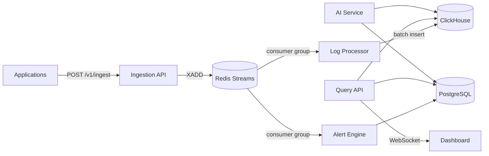

# Architecture

## Overview
Modular monolith in Go plus one separate Python AI service. Ingestion is decoupled from storage by a queue so bursts do not overload the database.



## Components
- **Ingestion API**: authenticates API key, validates batch, enforces rate limit and size limit, writes to Redis Stream, returns `202 Accepted`.
- **Log Processor**: consumer group worker. Parses, normalizes, computes fingerprint, batches inserts into ClickHouse (by size or 1 s), acknowledges only after a successful write.
- **Alert Engine**: evaluates rules on a sliding window; opens incidents and sends notifications.
- **Query API**: REST + WebSocket for the dashboard; always scoped by `project_id`.
- **AI Service**: anomaly detection and root-cause suggestions. Called by the backend over HTTP.
- **Dashboard**: React + TypeScript.

## Ingestion API (v0.1 contract)
```
POST /v1/ingest
X-API-Key: <project key>
Content-Type: application/json

{ "events": [
  { "timestamp": "2026-11-06T10:15:30.123Z", "level": "error", "service": "checkout",
    "message": "payment gateway timeout", "trace_id": "abc123",
    "attributes": { "env": "prod", "region": "eu-1" } } ] }
```
Responses: `202` accepted, `400` invalid, `401` bad key, `413` too large, `429` rate limited.

## Data model

### ClickHouse
```sql
CREATE TABLE logs (
  project_id  UUID,
  timestamp   DateTime64(3),
  level       LowCardinality(String),
  service     LowCardinality(String),
  message     String,
  fingerprint UInt64,
  trace_id    String,
  attributes  Map(String, String),
  ingested_at DateTime64(3) DEFAULT now64(3)
) ENGINE = MergeTree
PARTITION BY toYYYYMMDD(timestamp)
ORDER BY (project_id, service, timestamp)
TTL toDateTime(timestamp) + INTERVAL 30 DAY;
```

### PostgreSQL
`users`, `projects`, `api_keys` (hash only), `alert_rules`, `error_groups`, `incidents`, `incident_events`, `deploy_events`.

## Fingerprinting
Normalize the message (strip numbers, UUIDs, hex, timestamps, paths), hash the normalized template plus service plus level. Same template = same error group. Refined later with similarity clustering.

## Agent integration (planned, v1.0)
LogSage exposes a stable REST API and outgoing webhooks so external agents can query logs, read incidents, and post actions. A Model Context Protocol (MCP) server wrapper is planned so LLM agents can use LogSage as a tool. Design implication: every capability must be available through the API, not only the UI.

## Risks
| Risk | Mitigation |
|------|------------|
| Ingestion bursts overload storage | Queue + batched inserts, backpressure and `429` |
| High-cardinality attributes bloat ClickHouse | Attribute count/size limits, `Map` type, documented limits |
| Poisoned or oversized payloads | Size limits, strict validation, rate limit per key |
| Cross-project data leak | Mandatory `project_id` filter via a single query builder, tested |
| False-positive anomalies | Start with simple statistical baselines, measure before adding ML |
